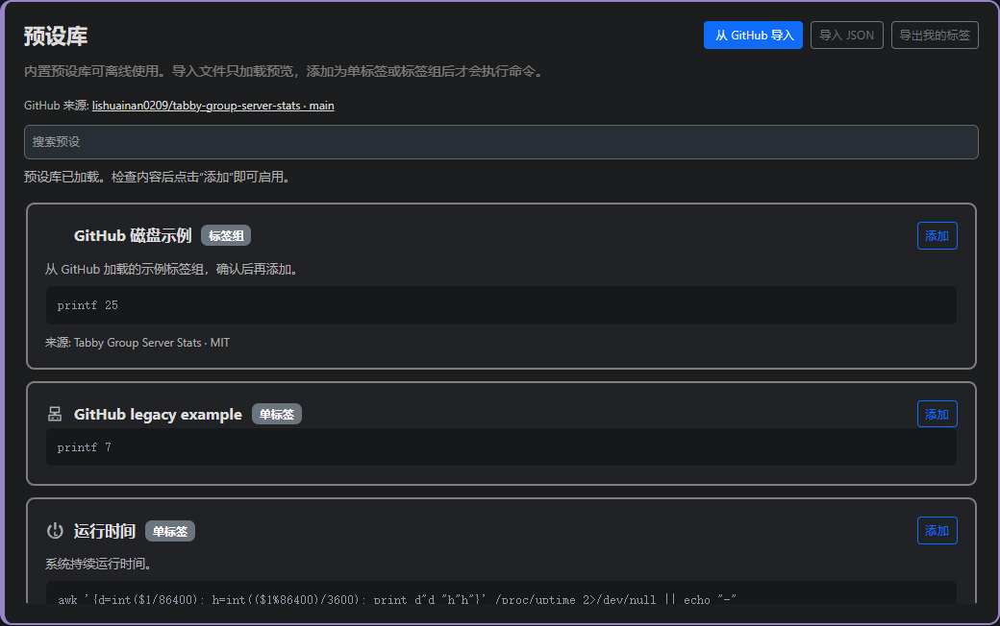

# Tabby Group Server Stats

[中文](README.md) | English

SSH server monitoring for [Tabby](https://github.com/Eugeny/tabby): CPU load, memory, disk capacity, network rates and GPU memory metrics. Add custom shell commands, hover details and metric groups with overview, carousel or static layouts. The current source version is **1.8.1**, preserving collection caches on display changes and label visibility during refreshes.

Fork author and maintainer: [lishuainan0209](https://github.com/lishuainan0209). This is an MIT-licensed fork of [Akkariin's tabby-server-stats](https://github.com/kasuganosoras/tabby-server-stats). The version number alone does not mean that the package has been published to npm.

**1.7.6 updates:** saving edits, adding or deleting metrics, and changing display scopes automatically refresh the bar. The P3 disk preset now covers `/`, `/data` and `/data2`. Per-pane menus, copying and bilingual offline tutorials from 1.7.5 remain available.

**The SSH hotfix from 1.6.1 is retained.** Previously, oversized SSH execution requests could disconnect the entire connection when many metrics were enabled. A fixed short command now receives the script through standard input in 8 KiB chunks, retaining the bounded completion acknowledgment. Transfer failures close only the statistics channel, without deliberately closing the terminal session or automatically rerunning user commands.



The preview uses example configuration data and the Chinese interface.

## 1.8.0 lower-overhead collection and disk I/O

- Conditional colors now include labels, built-in icons and uploaded icons; separators have stronger contrast and stretch to the tallest item on each wrapped line, while shorter labels remain centered. External URL images retain their original colors to avoid cross-origin mask failures.
- Lab-only disk capacity and I/O groups cover P0–P4, with a separate P1 container preset and connection bindings.
- Primary value: combined MB/s. Hover: bilingual read/write throughput, average latency in milliseconds, and average outstanding I/O requests, with right-aligned numeric columns. Outstanding requests include waiting and in-service I/O, not files, and the average can be fractional. Counters belong to backing block devices, not exclusive directory traffic; identical device IDs are deduplicated. MB uses the plugin's base-1024 convention.
- A 1-second snapshot window every 30 seconds, not a continuous 30-second average. Idle await is “-”. Unsupported Overlay/NFS or absent devices remain unavailable instead of returning fake zeros. No benchmarks, sample-file writes or iostat dependency.
- Defaults: network 5s, memory 10s, CPU load 15s, users/GPU/disk I/O 30s, disk capacity 60s. Explicit custom intervals remain editable.
- Background tabs, collapsed bars, disabled metrics and out-of-scope connections start no new collection; in-flight commands finish or time out. Visible split panes all collect. Overview/carousel children still refresh; hidden failed prerequisites retry at least 60s apart to detect recovery.
- At most four metrics run concurrently per batch. Hover queries share a batch, cached results and in-flight requests. Independent SSH connections still add overhead.

See [iostat](https://man7.org/linux/man-pages/man1/iostat.1.html) and [Linux I/O statistics](https://docs.kernel.org/admin-guide/iostats.html). Appropriate throughput, latency and queue thresholds depend on the device and workload, so these presets do not impose universal thresholds.

## Features

- **Standalone labels:** text or progress bars with individual icons, units, color rules, refresh intervals and timeouts.
- **Three command stages:** optional object check, primary shell command and optional hover-detail command.
- **Metric groups:** one main label and multiple children, with overview, carousel, horizontal static and vertical static displays.
- **Independent switches:** disable a standalone label, an entire group, its main label or individual children without deleting commands or color rules.
- **Connection scopes:** select saved connections or layouts; each pane in a mixed layout retains its own connection identity.
- **Editable, reorderable built-ins:** customize memory, network and CPU load, move them up or down in the bottom bar, or restore one built-in's defaults.
- **Independent copies:** duplicate an entire group or a child within its group, then adjust device paths, GPU indices and commands.
- **Per-pane display menus:** choose Show, Hide, Overview, Carousel or Static from a vertical lower-left menu; choosing a mode also shows the bar, and each pane remembers its selection.
- **Offline PDF manuals:** a highlighted **Tutorial (PDF)** button opens the Chinese or English manual with the system's default PDF application, covering pane menus, label editing, presets and a disk-group walkthrough.
- **Offline and GitHub library:** 37 bundled presets—13 standalone labels and 24 groups—with imports from this fork, JSON import/export and search; repeated clicks do not add another copy of an existing preset.
- **Clear section and card borders:** separate built-ins, presets, standalone labels and groups; compact line separators between displayed groups.
- **English/Chinese UI and 26 original monitoring icons:** searchable categories, existing icon support and custom SVGs.

Display is fixed to the bottom status bar, with an enable switch in settings. Legacy floating-panel preferences automatically use the bottom bar. Built-ins use the same checks, colors, scopes and details as custom metrics. Standalone details open above the bar without widening it. Group overview/carousel popups and static hover behavior retain their existing rules.

## Create a label

Open Tabby Settings → Bottom Status Bar, then choose **Add single label**, or find a library preset and click **Add**. Importing from GitHub or JSON loads choices into the library; adding a preset puts it into the active configuration. Use the pencil button to edit an existing item. Within a group, each main/child label opens its own editor.

To get started, click the highlighted **Tutorial (PDF)** button at the top of settings. The complete manual ships with the plugin for offline use and opens in the system's default PDF application, choosing Chinese or English from the interface language. It starts with the lower-left menu, built-ins and standalone labels, then walks through finding mount points and configuring system/data disks and an aggregate value. Continue with copies, enable switches, colors, display scopes, preset import/export and troubleshooting. You can also read the [English PDF](docs/tutorial.en.pdf) or [中文 PDF](docs/tutorial.zh-CN.pdf) directly.

Group cards place the main label and child labels on separate adjacent rows. The group's pencil button opens its editor with every member collapsed; clicking a bordered label button opens that member directly. Delete buttons sit at the lower right of their cards and ask for confirmation with the item's name. Deleting a child takes effect only after saving the whole group.

Click a group card's **Duplicate** button to create and save an independent copy immediately after it, then open that copy for editing. Commands, scopes, styling and enabled states are retained, while the group and every member receive new IDs. Editing the copy does not change its source. Inside the group editor, a child's **Duplicate** button inserts a copy after that child and opens its editor; this remains a draft until you save the whole group. Deliberate copies do not retain the source preset's duplicate-detection identity, unlike repeatedly clicking **Add** in the library.

New labels default to **text** and checks default to **output-text comparison**. Configure commands in this order:

1. **Object check, optional:** compare trimmed standard output or an expected exit code. Without a check, the primary command runs directly.
2. **Shell command:** periodically collects the primary value.
3. **Hover detail command, optional:** a standalone label opens its primary value and details in a popup above the bar, closing on mouse leave. An empty command makes no detail request. Group members expand according to the group's display mode.

For a separate filesystem mounted at `/data2`:

```sh
# Check: choose exit-code comparison, expected value 0
mountpoint -q /data2

# Primary command: text type, % suffix
data=$(df -P /data2) || exit 1
printf '%s\n' "$data" | awk 'NR==2 {gsub(/%/, "", $5); print $5}'

# Hover details
data=$(df -hP /data2) || exit 1
printf '%s\n' "$data" | awk 'NR==2 {print "available " $4 " / used " $3}'
```

Set the unavailable message to “Not mounted”. Checking the mount point prevents an unmounted disk's remaining directory from reporting its parent filesystem instead. A failed check skips both the primary and detail commands. Commands run inside the corresponding pane's session with that connection user's permissions and require the appropriate tools on the target.

Entering a label immediately requests its value and details, bypassing the normal long cache interval. While hovered, it refreshes about once per second; leaving restores the configured interval without changing saved settings. Standalone and horizontal static labels accelerate only the pointed-at item; overview, carousel and vertical static groups accelerate their expanded visible items. Labels without detail commands also refresh their primary values, and moving into the popup keeps the faster cadence. Hidden children with failed checks get one extra probe when entering their group. Failed items remain hidden and their independent commands are excluded from accelerated polling; normal polling retains its retry interval of at least 60 seconds. Recovered items reappear and join fast refresh. Aggregate labels still perform their own lightweight candidate-mount checks. Repeated mouse/focus events reuse in-flight requests; slow commands are not restarted while running, so actual refresh speed depends on command duration. Hidden panes and background documents stop new collection. A bounded SSH completion acknowledgment protects output from fast-closing channels without automatically retrying user commands. Detail errors appear separately in red and preserve a healthy primary value; successful empty detail output stays empty.

## Groups and visibility

Group names appear in the hover popup, without a repeated prefix in the status bar. The main label is flush left, children are indented, and popup names, values and details align in columns. Capacity numbers have thousands separators, such as `7,912 GB`. In details such as `433.9/8,786.0 GB`, each side of the slash is independently right-aligned, retaining the original decimal precision and raw values for color rules. Thin separators and smaller gaps between groups conserve status-bar width.

- **Overview:** shows the main label; hover opens the full group vertically with details.
- **Carousel:** rotates through child labels; hover pauses rotation and opens the full group. Skipped children do not consume extra rotation periods.
- **Horizontal static:** shows main and child labels together; only the hovered label expands its details.
- **Vertical static:** shows all labels vertically; hovering the group expands their details together.

After the initial results arrive, a carousel reserves the width of its longest candidate. Later, longer output wraps within that fixed width, including in narrow split panes. Collection and rotation have separate intervals. A failed main-label check does not block its children.

| Setting | Normal display and collection | When the object check fails |
| --- | --- | --- |
| `enabled: false` | No display or execution; disabling a group affects every member | Checks also stop |
| `visibleWhenUnavailable: true` (default) | Normal operation | Keep the failure notice in all views |
| `visibleWhenUnavailable: false` | Normal operation | Hide in every view; keep checking for recovery |
| `showWhenUnavailable: false` | Normal operation | Skip only in the carousel; other views follow the setting above |

An unavailable child participates in the carousel only when both visibility flags permit it. Turning off global unavailable visibility also turns off carousel participation in settings. **Timeouts, connection failures and primary-command errors are not missing-object results**, and these visibility flags do not hide them. Omitted settings retain legacy behavior: enabled, with failure notices visible. Individual presets may explicitly override these defaults.

Disabling the main label does not disable its children. Disabling one child leaves its siblings active. A group uses its empty-state text when no carousel child is eligible; a group whose every member is disabled or hidden disappears entirely.

## Editable built-ins

New configurations have only three built-ins: **memory, network and CPU load**. Memory is a standalone label. Network is a vertical static group with download/upload children; its main label starts disabled. CPU load is an overview group with runnable/total thread counts as its main value and 1min/5min load percentages normalized by logical processor count as children. All use the common commands, checks, details, scopes and color rules rather than a separate hardcoded chart collector.

During upgrades, enabled legacy CPU/disk built-ins and edited overrides are preserved as ordinary standalone labels, retaining commands, scopes and enabled states. Existing custom CPU-load groups stay in place; when an existing group is recognized as that preset, the new built-in CPU-load group starts disabled to avoid duplicate displays.

Use each card's up/down buttons to reorder memory, network and CPU load. The order is persisted in `builtinOrder` and retained after restarting. Custom labels and groups retain their existing relative order.

**Restore defaults** removes only the selected built-in's override, preserving its top-level enable switch and ordering, and leaving other built-ins and custom labels untouched. Restoring network or CPU load resets that group's main/child definitions to their factory configuration.

Memory, network and CPU-load commands support Linux/macOS; most other library presets target Linux. Download and upload show the current received/sent rates in decimal MB/s with three fractional digits and thousands separators. Commands still return KiB/s; thresholds continue to use raw values. Each direction's hover detail shows its own cumulative GB and the interfaces included. Default-route interfaces are preferred; without a usable default route, eligible non-loopback interfaces are used. **Totals cover the time since interface creation or counter reset, not since the current SSH login.**

Capacity and cumulative traffic use the **GB** label while retaining the existing base-1024 calculation (1024³ bytes per displayed unit). Only the unit name changes; readings and alert thresholds stay the same. Network rates in MB/s remain decimal.

The target system needs `timeout`, `gtimeout` or `setsid` for bounded command execution.

## Offline and GitHub preset library

The shipped library works offline. **Import from GitHub** reads [this fork's main-branch presets](https://github.com/lishuainan0209/tabby-group-server-stats/blob/main/presets.json), rather than the upstream project's URL. Successful imports merge into the current library, retaining local and earlier imported entries and replacing matching IDs. A failed fetch leaves the current list intact. Remote `main` reflects what has actually been pushed and may differ from the local version.

GitHub and JSON imports only preview entries: they do not execute commands or add status-bar items until you click **Add**. GitHub downloads have a 15-second timeout and a 2 MiB size limit, and do not upload local configuration or connection information. Search or export the current custom standalone labels and groups; exports omit built-in overrides. The format supports `kind: "metric"` and `kind: "group"`, and accepts the original flat metric array.

**Add each preset once.** Newly added standalone labels and groups record their source and stable preset ID. Renaming or disabling an item does not allow another copy to be added from the same preset. Legacy configuration without source markers is checked using commands and display scope rather than its name alone. This protection does not automatically delete historical duplicates: back up local configuration before removing unwanted copies.

The 13 standalone presets cover uptime, temperature, system load, logged-in users, Docker containers, GPU usage and free memory, SSH sessions, SSH latency, I/O wait, CPU steal, failed services and service state. The 24 groups include seven sets of disk free-capacity, usage and I/O presets, plus GPU usage, GPU free and CPU load. Their disk paths are:

**Laboratory-specific presets: P0磁盘, P1磁盘, P1容器磁盘, P2磁盘, P3磁盘 and P4磁盘 are for the author's laboratory only. Other users: please do not download or use these presets.** Their mount paths and saved connection names are specific to the author's laboratory; they are not generic server templates. This usage-scope notice does not apply to the general GPU or CPU-load presets and does not change the rights granted by the MIT license.

| Group | Main label and children | Suggested saved connections |
| --- | --- | --- |
| P0磁盘 | System `/`, `/data`; future candidates `/data2`–`/data4` | P0(ai), P0(s_lsn) |
| P1磁盘 | Aggregate free capacity; system `/` child only | P1(ai) |
| P1容器磁盘 | Aggregate free capacity; system `/`, then `/public` | P1(s_lsn) |
| P2磁盘 | System `/`, `/data`; future candidates `/data2`–`/data4` | P2(ai), P2(s_lsn) |
| P3磁盘 | System `/`, `/data`, `/data2`; optional `/data3`, `/data4` | P3(ai), P3(s_lsn) |
| P4磁盘 | System `/`, `/data`; optional `/data2`–`/data12` | P4(ai), P4(s_lsn) |
| NAS磁盘 | System `/`; optional `/volume1`–`/volume4` | NAS |
| GPU usage / GPU free | Aggregate GPU memory; eight children GPU 0–7 | All panes |
| CPU load | Thread count; 1-minute and 5-minute load | All panes |

Each free-capacity group's main label shows **aggregate free GB** across its readable system and mounted data filesystems, deduplicating filesystems so bind mounts are not counted twice. The system disk is the first child, followed by data mounts; hover shows free/total capacity. The corresponding usage presets show used percentages and used/total capacity. I/O presets use the same candidate paths.

New optional mounts hide when their prerequisite check fails, are excluded from carousel rotation and valid-mount totals, and return on a later successful sample after mounting. Existing system/data mounts retain failure notices. With no readable valid filesystem the aggregate reports an error. P0/P2 paths `/data2`–`/data4` are reserved for future mounts: **they are not a claim that these paths are mounted or evidence of either server's physical drive-bay count**. NAS presets bind to the personal NAS connection and are outside the laboratory-only set.

The **Users** preset counts system login records from `who`, including normal tty, pts and console sessions. Hover groups and sorts counts by username, for example `alice ×2, bob ×1`. Empty records produce a primary value of `0` and a detail of `-`; missing tools or execution failures remain errors. This is neither the current connection's username nor a count of every TCP or background SSH connection.

GPU percentages mean **VRAM usage** (`memory.used / memory.total`), not `utilization.gpu`. The GPU usage details use `memory.used`, retain the division by 1024, and show used/total memory with the GB label. The main GPU label keeps a no-GPU notice; nonexistent GPU children are hidden in every view by default.

The P1 host and container are separate presets bound to separate saved connections. They must not be merged merely because they share a host address and use different ports.

If a faulty device blocks an all-GPU query, the aggregate command queries GPU 0–7 individually and sums readable devices. With no readable device it shows “No GPU”; this means the query is unavailable, not proof that no GPU is installed.

Suggested names resolve **when adding** a preset and must uniquely match a local saved profile. Missing or ambiguous names require manual selection, and the scope stays restricted. With no resolved profiles, it remains explicitly selected-empty and neither displays nor executes. Subsequent matching uses local stable profile IDs. Shared exports express connection bindings through names; review your own commands and descriptions before sharing them.

## Default color thresholds

The corresponding built-ins and presets use green `#00ff00`, orange `#ffa500` and red `#ff0000`. Rules match from top to bottom, so **red rules precede orange rules**. Saved custom rules take precedence after editing.

| Metric | Red | Orange | Green |
| --- | --- | --- | --- |
| Free capacity per disk (GB) | `< 20` | `20 ≤ x ≤ 40` | `> 40` |
| Total free disk capacity (GB) | `< 50` | `50 ≤ x ≤ 100` | `> 100` |
| GPU memory usage (%) | `> 80` | `50 < x ≤ 80` | `≤ 50` |
| RAM usage (%) | `> 80` | `60 < x ≤ 80` | `≤ 60` |
| Normalized CPU 1min / 5min load (%) | `> 150` | `100 < x ≤ 150` | `≤ 100` |

GPU thresholds measure VRAM use, not GPU compute utilization. CPU load is normalized by the logical processor count and can exceed 100%.

## Connection scopes and mixed panes

A standalone label or whole group can select saved connections, whole layouts or individual panes within layouts. Layouts expand by default with indented pane entries. A pane remains selectable after its original connection profile is deleted, as long as the saved layout retains its copy. The default unrestricted scope covers every supported terminal pane. Group members inherit the group's scope; an unmatched pane does not run even the object's check.

Checking a connection selects every entry with the **same original connection ID**; unchecking affects only that entry. Per-pane opt-outs override connection-wide or layout-wide selections and survive saving, reopening and JSON export/import. A layout checkbox selects or clears only its own panes. Equal names with different IDs do not link selections.

Matching prioritizes each pane's **original saved connection ID**, not the focused pane, tab title or a sibling connection. If an old saved layout retains an obsolete connection ID, the plugin looks for exactly one current SSH profile with the same host, port, username and jump/proxy route. Missing or ambiguous matches do not inherit a scope. Hosts and containers on different ports remain separate. This compatibility fix is included in 1.7.4.

In a `P1 / P2 / P1` layout, P1-bound metrics appear in both P1 panes and P2-bound metrics only in the middle pane. A layout-bound metric applies to all three, executing independently in each session. Multiple selections form a union: choosing P1 plus the whole layout also includes its P2 pane.

Renaming preserves the association. Deleted profiles remain marked unavailable and stop matching; a new profile with the same name does not inherit the old ID. Removing the last selection does not make the metric global—you must explicitly choose all terminal panes.

Saved layouts have IDs separate from the connections inside them. The plugin records a layout's origin when it is opened and retains that marker in recovery data. Whole-layout and individual-pane bindings require an unmarked layout already open before installation, or a newly saved layout, to be reopened once from the saved-profile list. Direct connection-ID bindings need no such reopening.

Individual pane bindings also require that layout-origin marker; reopen an unmarked old window from its saved layout once. Pane targets combine the layout ID, saved position and original connection ID, so repeated connections can be unchecked individually. After editing a saved layout or removing/replacing panes, review unavailable scope entries and select the intended targets again.

Click each pane's lower-left button to open a vertical menu: **Show, Hide, Overview, Carousel, Static**. Show/Hide controls that pane's entire status bar, while the button remains available when hidden. Choosing Overview, Carousel or Static automatically shows the bar and saves both visibility and mode; no extra Show action is needed. The three modes override the presentation of groups in that pane; Static retains each group's horizontal/vertical layout, and standalone labels are unaffected. Choosing a mode does not modify shared group definitions. Without a pane override, each group uses its configured mode.

Saved layouts remember visibility and mode for each pane. For three identical connections, choose Hide in the first two and Carousel directly in the third to show it. The layout retains those choices when reopened, without affecting other layouts.

The menu opens on click and stays open while crossing the gap above the icon, including when Tabby's focus-follows-mouse setting is enabled. Selecting an option, clicking the icon again or outside, pressing Escape, or tabbing out closes it. Changing sessions or removing the pane also closes the old menu.

## Install, develop and publish

In **Tabby Settings → Plugins → Available**, search for **`maintainer:lishuainan0209`**, install **`group-server-stats`**, then restart Tabby. Filtering by maintainer makes the package easier to find when a newly published package appears low in a long result list. You can also search for `tabby-group-server-stats`; Tabby omits the `tabby-` prefix from the displayed name.

The description and keywords cover server monitoring, GPU memory, disk, network and metric groups. npm matches package names, descriptions, README content and keywords; npm controls result ordering, so metadata changes do not guarantee a particular ranking or immediate visibility. [npm search documentation](https://docs.npmjs.com/searching-for-and-choosing-packages-to-download/)

See the [npm package page](https://www.npmjs.com/package/tabby-group-server-stats) for public versions. Test unpublished local versions with a `.tgz`. A GitHub fork, a successful build, npm publication and Tabby's search index are separate steps.

Development needs Node.js, npm, Git and Tabby. Global Angular CLI/Webpack installations and Python are not required for this project. Keep the lockfile and `.npmrc`, then run from the repository root:

```powershell
Set-Location -LiteralPath 'D:\tabby-group-server-stats'
npm.cmd ci
npm.cmd run typecheck
npm.cmd test
npm.cmd run test:ui
npm.cmd pack
```

`npm pack` reruns type checking, unit tests and the production build, producing `tabby-group-server-stats-1.7.5.tgz`; compiled files are in `dist/`. Browser tests use real Angular components with simulated data, while command tests use a local shell. Live SSH command validation and desktop split-pane acceptance need their own recorded results.

This fork retains `plugin.serverStats` configuration compatibility. **Enable either the upstream plugin or this fork in a Tabby instance**, to avoid duplicate collection. An isolated portable Tabby installation is recommended for initial testing. See the [packaging, local-installation and publishing guide (Chinese)](PUBLISHING.zh-CN.md) for commands and acceptance checks.

## License and contributions

Original project: [kasuganosoras/tabby-server-stats](https://github.com/kasuganosoras/tabby-server-stats), by Akkariin, Copyright (c) 2023 Akkariin Meiko. [LICENSE](LICENSE) preserves the original MIT text, and [NOTICE](NOTICE) describes this fork's attribution and changes. The 26 new monitoring icons use MIT as well; dependencies retain their own licenses and notices.

Report problems or suggest improvements through [this project's Issues](https://github.com/lishuainan0209/tabby-group-server-stats/issues). Shared presets should state required tools, metric meaning and source licenses.

### 1.7.2 display fixes

- Convert KiB/s readings to MB/s with three fractional digits.
- Remove gaps between static vertical rows, add thin separators, and reduce bottom-bar padding.
- Right-align numeric columns and both sides of capacity ratios; hover popups retain comfortable spacing.

### 1.7.3 attribution, duplicate presets and discovery

- Identify lishuainan0209 as this fork's author and maintainer, including fork preset sources.
- Retain Akkariin's upstream MIT copyright, source links and contributor credit.
- Prevent duplicate preset additions using source and stable ID, including renamed or disabled items; use commands and scope to recognize legacy entries.
- Add relevant bilingual metadata and document installation through maintainer search, without promising a search ranking.

### 1.7.4 pane controls and editing

- Bind individual saved-layout panes, link checks for matching connection IDs and allow individual opt-outs, including legacy layout profiles.
- Use a fixed bottom bar with a persistent, independent lower-left toggle for each pane.
- Put main/child buttons together for direct editing; collapse group editors initially and move named deletion confirmations to the lower right.
- Display capacity as GB while retaining base-1024 readings and thresholds, with compatibility for legacy GiB configuration.

### 1.8.0 tutorial PDF launch fix

- Resolve the bundled tutorial to a normalized absolute path and await the system PDF opener.
- Show localized feedback when the file is missing or the default reader cannot open it.

### 1.7.6 automatic refresh and P3 disk paths

- Saving edits, adding or deleting metrics, and changing display scopes immediately reload open panes and collect fresh data. Old responses cannot overwrite the new configuration, and hidden panes remain hidden.
- The P3 disk preset covers only system `/`, `/data` and `/data2`, with matching aggregate and child commands.
- Both manuals explain automatic refresh and how to check duplicate groups and aggregate mount paths.

### 1.7.5 pane menus, copies and user manuals

- Use a vertical lower-left menu to persist each pane's visibility and Overview/Carousel/Static mode. Choosing a mode also shows the bar without changing shared group definitions.
- Duplicate groups and children independently; group copies are created immediately, while child copies belong to the group editing draft.
- Open standalone hover details above the bar, retain static-group behavior and remove redundant white name tooltips.
- Add thousands separators to capacity values and right-align primary values and both sides of ratio details.
- Limit built-ins to memory, network and CPU load, preserving enabled or edited legacy CPU/disk definitions.
- Open bundled English/Chinese complete user manuals, including the disk-group walkthrough, through the highlighted tutorial button.
- Fix the lower-left menu closing as the pointer moves upward with focus-follows-mouse enabled.
- Fix a configuration migration incompatibility that left the settings page blank, and persist built-in ordering and first-time edits across restarts.

The library offers GPU usage/free presets and P0–P4 disk usage/free groups. GPU values are VRAM percentages and details follow the chosen direction; free below 20% is red, below 50% orange. Disk usage reads the df Used column (excluding reserved space), shows used percentage and used/total details, and turns orange above 80% or red above 90%. Disk free retains free GB and its existing capacity thresholds.

### 1.8.1 I/O reference colors

Readings remain the sum of read plus write throughput across unique readable block devices during the approximately one-second sample, not a per-disk average. Colors compare this rate with a reference sequential bandwidth: green below 80%, orange from 80%, red from 95%. Aggregate references include only currently readable devices; duplicate mount aliases use the smaller reference once, and absent future mounts do not inflate the denominator. Manufacturer decimal MB/s is converted to the existing base-1024 display units.

Verified on 2026-11-08 with ordinary-user read-only access: P3 root is a ZHITAI TiPlus7100 1TB (7000 MB/s reference), /data is WD80EFPX-68C4ZN0 8TB (215), /data2 is ST8000NM017B-2TJ103 8TB (255); P1 container /public maps to a TiPlus7100 2TB NVMe partition (7000). P0 root is reported nonrotational behind PERC H355, so its unknown physical model uses a provisional 500 MB/s SSD-class reference. Other unknown disks and future mounts use a conservative 180 MB/s 4/8 TB HDD reference. P0/P2 physical models are obscured by PERC H355/H330; the controller name is not the drive model. P1 exposes a WD42EJRX 4TB but its relationship to the container's root ZFS dataset is unconfirmed. Existing ordinary keys could not authenticate P4/NAS. These fallback references are assumptions, not measured drive performance.

This is a sequential-throughput reference, not health, saturation or utilization: random I/O may be busy at low MB/s. All four detail columns inherit their row's throughput color; latency/queue are not independently classified by these thresholds. Sources: [WD Red Plus](https://documents.westerndigital.com/content/dam/doc-library/en_us/assets/public/western-digital/product/internal-drives/wd-red-plus-hdd/data-sheet-western-digital-wd-red-plus-hdd.pdf), [Seagate Exos 7E10](https://www.seagate.com/www-content/product-content/enterprise-hdd-fam/exos-7e10/_shared/docs/200440800e.pdf), [YMTC TiPlus7100](https://www.ymtc.com/cn/news/49.html). The 80/95% thresholds are this plugin's display policy, not manufacturer fault thresholds.


### 1.8.1 Preserve visibility during refresh

Moving an icon or changing pane display preferences preserves connection caches, in-flight work and hidden-item retry timers. Every label configured to hide when unavailable, including group mains and children, starts hidden and retains its last check decision throughout refreshes. Complete results update visibility; connection errors do not reveal hidden labels. Edited commands discard old readings while retaining known visibility. New sessions and different binding contexts check independently. Groups disappear when all members are hidden.

### 1.8.1 Icon position

The pane control menu offers top-left, top-right, bottom-left and bottom-right (default). Position persists per pane. Only the icon moves; metric labels remain in the bottom bar. Hiding the bar keeps the icon in its selected corner.

### 1.8.1 Local editor update (2026-11-12)

Labels align to the top and group main titles are bold. Hover still accelerates collection; clicking immediately expands a collecting placeholder, then fills in the response. Existing details remain visible during refresh. Another click or moving away closes them. The editor adapts to available width between 640px and 1440px, with horizontal scrolling below its minimum. The draggable navigator defaults to the right center, adapts between 220px and 300px, and scrolls long lists internally. It can overlay menus or the editor without consuming form width; its arrow returns it to the right side. Navigation scrolls member headings into view. Multiple members can stay open with independent drafts. Ctrl+S saves all drafts in the current group and folds only the active member. Single labels also have navigation and shortcut saving. Closing offers save, discard or continue editing. Delete buttons identify their targets; editor icons use the configured default color.

The 43 bundled disk I/O prerequisite commands are about 43.5% shorter in total with the same mount and counter validation. Sampling, deduplication, mapping-change checks and colors are unchanged. Startup migrates only exact old generated checks, preserving customized scripts.

The pane icon menu offers top or center label alignment (top by default), saved independently per pane. Switching preserves collectors and mounted strips; separators retain the full row height.
