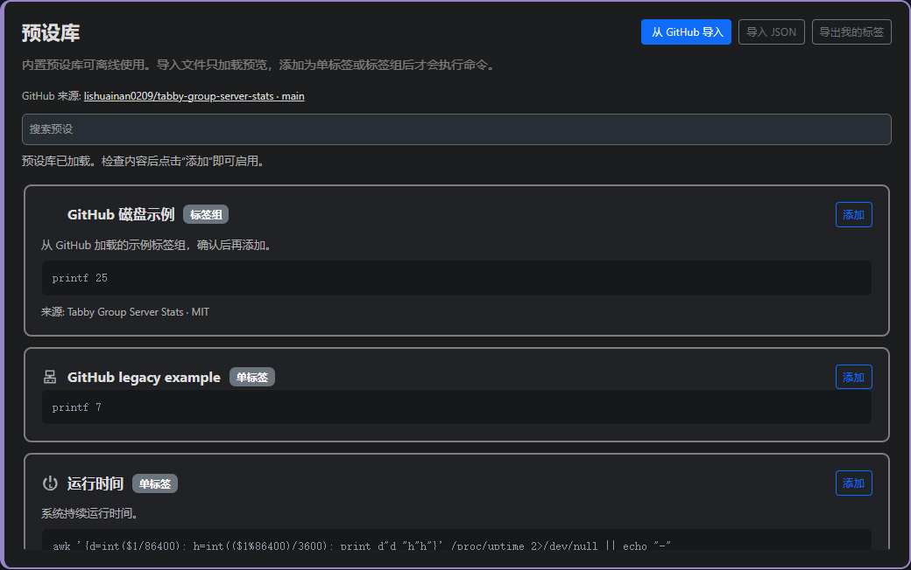

# Tabby Group Server Stats

中文 | [English](README.en.md)

为 [Tabby](https://github.com/Eugeny/tabby) 提供 SSH 服务器监控（server monitoring）：CPU 负载、内存、磁盘容量、网络速率和 GPU 显存指标。支持自定义 Shell 命令、悬停详情，以及概览、轮播、静态显示的多标签组（metric groups）。当前版本为 **1.7.3**，加入预设重复添加保护，保留紧凑底栏、MB/s 三位小数及容量数字分列对齐。

本 fork 作者及维护者：[lishuainan0209](https://github.com/lishuainan0209)。本项目基于 [Akkariin 的 tabby-server-stats](https://github.com/kasuganosoras/tabby-server-stats) 二次开发，继续使用 MIT 许可证。版本号不代表已经发布到 npm。

**源码更新（尚未发布 npm）**：布局内分屏可独立选择；同连接 ID 勾选联动、取消逐项生效；固定底部栏，每个分屏左下角提供独立显示开关。

**保留 1.6.1 的 SSH 热修复**：此前指标较多时，超长 SSH 执行请求可能导致整个连接断开。执行请求已改为固定短命令，脚本通过标准输入按 8 KiB 分块传输，保留完整接收后的有时限确认。传输失败只关闭本次统计通道，不主动关闭终端会话，也不会自动重跑用户命令。



上图使用示例配置展示离线预设库。

## 功能一览

- **单标签**：文本或进度条，独立图标、单位、颜色规则、刷新频率和超时。
- **三条命令**：对象校验 → Shell 功能命令 → 悬停扩展信息；校验失败时不执行后两条。
- **标签组**：主标签与多个子标签，支持概览、轮播、静态横排和静态竖排。
- **分别启用**：单标签、整个标签组、组内主标签和每个子标签都能独立开关，配置及颜色规则保留。
- **按连接或布局分屏显示**：多选保存的连接、整个布局或布局内单个分屏；同连接 ID 勾选联动，取消可逐个进行。
- **可编辑、可排序的内置指标**：CPU、内存、磁盘和网络可修改命令与样式，使用上下移按钮调整底部状态栏的显示顺序，也可单独恢复默认。
- **离线与 GitHub 标签库**：内附 20 个预设（12 个单标签、8 个标签组），支持从本 fork 的 GitHub 导入、JSON 导入导出和搜索；已添加的预设不会因重复点击而产生副本。
- **清晰的区域与卡片边框**：内置指标、预设库、单标签、多标签组四块区域分别显示；状态栏组间采用紧凑细线分隔。
- **中英文界面与 26 款原创图标**：图标按用途分类、可搜索，也支持原有图标和自定义 SVG。

显示方式固定为底部状态栏，设置页提供启用开关；旧配置中的浮动面板模式自动按底部栏处理。内置指标遵循与自定义标签相同的校验、颜色、范围和悬停规则，标签组的悬停详情弹窗仍保留。

## 从一个标签开始

在 Tabby 设置 → 底部状态栏中，点击“添加单标签”，或从标签库选择一个预设后点击“添加”。从 GitHub 或 JSON 导入都只加载可选条目；点击“添加”才把对应条目加入当前配置。已有项目使用铅笔按钮编辑，组内主、子标签点击后分别展开编辑框。

标签组卡片中，主标签与子标签分两行排列。点击标签组的铅笔按钮进入编辑时，主、子标签默认全部折叠；点击带边框的标签按钮则直接展开并编辑对应项目。删除按钮位于各自卡片右下角，并弹出包含名称的确认提示；子标签删除后仍需保存整个标签组才会生效。

新建标签默认使用**文本值**，校验默认比较**输出文本**。每个标签的命令顺序为：

1. **对象校验命令，可选**：比较去除首尾空白后的输出文本，或指定退出码。未配置则直接执行功能命令。
2. **Shell 功能命令**：定时采集状态栏主值。
3. **悬停扩展信息命令，可选**：悬停时将结果追加到主值后，移出收起；留空不请求扩展信息。

例如，检查独立挂载的 `/data2`，显示使用百分比：

```sh
# 对象校验：选择“退出码”，期望值设为 0
mountpoint -q /data2

# Shell 功能命令：类型“文本”，后缀 %
data=$(df -P /data2) || exit 1
printf '%s\n' "$data" | awk 'NR==2 {gsub(/%/, "", $5); print $5}'

# 悬停扩展信息
data=$(df -hP /data2) || exit 1
printf '%s\n' "$data" | awk 'NR==2 {print "available " $4 " / used " $3}'
```

将校验失败文字设为“未挂载”。`mountpoint` 用于区分真正挂载的磁盘与仅剩目录，避免磁盘掉线后误读父文件系统容量。命令在对应窗格的会话内、以当前连接用户的权限执行；需要服务器具有命令使用的工具。

扩展信息按该标签的刷新频率缓存，未设置时使用全局频率（默认 3 秒，最少 1 秒），持续悬停不会每次鼠标事件都重跑命令。快速完成的 SSH 命令使用有时限的结果接收确认，且不会自动重跑用户命令。扩展信息错误单独提示并标红，正常主值保留；成功但无输出的扩展命令保持为空。

## 标签组与可见性

组名只在悬停弹出框显示，状态栏直接显示标签内容。主标签顶格，子标签缩进，弹出框中的名称、数值和扩展信息按列对齐。组间使用细线和较小间距，减少有限状态栏宽度中的留白。

- **概览**：平时显示主标签；悬停后竖排展示整组及各自的扩展信息。
- **轮播**：按组的轮播间隔切换子标签；悬停暂停并展开整组。跳过无效子标签时直接选择下一个，不额外等待一个周期。
- **静态横排**：同时横向显示主标签与子标签，仅悬停的标签展开详情。
- **静态竖排**：同时竖向显示主标签与子标签，悬停整组时显示各项详情。

轮播首次结果返回后按最长候选项预留固定宽度；后续更长的内容在固定宽度内换行，窄分屏内也能完整显示。数据刷新间隔与轮播间隔彼此独立。主标签校验失败不会阻止子标签采集。

| 配置 | 正常显示与采集 | 校验失败时 |
| --- | --- | --- |
| `enabled: false` | 不显示、不执行该项；禁用组时包含全部成员 | 不再执行校验 |
| `visibleWhenUnavailable: true`（默认） | 正常运行 | 各视图保留失败提示 |
| `visibleWhenUnavailable: false` | 正常运行 | 所有视图隐藏该项，继续定时校验以发现恢复 |
| `showWhenUnavailable: false` | 正常运行 | 仅从轮播跳过；其他视图仍遵循上一项 |

参与失败状态轮播需要两个可见性开关同时允许。关闭“校验失败仍显示”时，设置页同时关闭“仍参与轮播”。**超时、连接失败、功能命令错误不属于“对象不存在”**，不会被这两个开关隐藏。旧配置省略开关时默认启用、默认显示失败提示；GPU 等特定预设可以主动覆盖默认值。

组内禁用主标签不会禁用子标签，禁用某个子标签也不会影响其他成员。没有可轮播子标签时使用组的空状态文字；全部成员都被禁用或隐藏时不显示整组。

## 内置指标也能编辑

CPU、内存、磁盘是单标签；网络是静态竖排标签组，默认显示下载和上传，主标签默认关闭。它们与自定义项目使用相同的命令编辑、对象校验、扩展信息、显示范围和颜色规则，不再另走硬编码图表采集路径。

使用卡片右侧上下移按钮调整 CPU、内存、磁盘和网络的顺序。顺序保存在 `builtinOrder` 中，重开后保留；自定义单标签和标签组仍按各自原有顺序排列。

“恢复默认”只删除当前内置项的自定义覆盖，保留它的顶层启用开关和排列顺序，不影响其他内置项或自定义标签。网络恢复默认会恢复该组的出厂主、子标签配置。

内置 CPU、内存、磁盘和网络均包含 Linux/macOS 适配，多数其他离线预设面向 Linux。网络下载、上传主值分别是当前接收、发送速率，显示单位为 MB/s（十进制），固定三位小数并带千位逗号；采集命令仍输出 KiB/s，颜色规则继续按原始数值判断；各自悬停显示对应方向的累计 GB 和参与统计的网卡。默认优先选择默认路由网卡，没有可用默认路由时回退到符合条件的非回环网卡。**累计量从接口建立或计数器重置起计算，不是本次 SSH 登录后的流量**。

容量和累计流量统一标为 **GB**，沿用现有的 1024 进制计算口径（每单位 1024³ 字节），仅调整单位名称，数值和告警阈值保持不变；网络速率 MB/s 仍使用十进制。

目标系统需要提供 `timeout`、`gtimeout` 或 `setsid` 之一，用于命令超时保护。

## 离线与 GitHub 标签库

库随插件提供，可直接离线使用。“从 GitHub 导入”会读取 [当前 fork 的 main 分支预设](https://github.com/lishuainan0209/tabby-group-server-stats/blob/main/presets.json)，不再读取旧项目地址。获取成功后合并到当前库，保留本地条目及之前导入的条目，同 ID 更新；获取失败保留原列表。远端 `main` 内容取决于实际推送状态，可能与当前本地版本不同。

从 GitHub 或 JSON 导入仅预览，不执行命令，也不自动添加到状态栏；逐项点击“添加”才生效。GitHub 获取具有 15 秒超时和 2 MiB 大小上限，不上传本地配置或连接信息。设置页还支持搜索和导出当前自定义单标签/标签组；导出不包含内置指标覆盖。JSON 同时支持 `kind: "metric"`、`kind: "group"`，也兼容原版的平铺单标签数组。

**同一预设只添加一次。** 新添加的单标签和标签组会记录来源与预设的稳定 ID；即使之后改名或禁用，再次点击同一预设也不会创建重复项。没有来源标记的旧配置，会结合命令和显示范围识别已有项目，避免仅凭名称误判。重复添加保护不会自动删除历史副本；清理已有重复项时，应先备份本地配置，再保留需要的那一份。

12 个单标签覆盖运行时间、温度、系统负载、登录用户、Docker 容器、GPU 显存、SSH 会话、SSH 延迟、I/O 等待、CPU Steal、失败服务和服务状态。8 个标签组如下：

**实验室专用预设说明：P0磁盘、P1磁盘、P1容器磁盘、P2磁盘、P3磁盘、P4磁盘均为作者实验室自用，其他人请勿下载使用。** 这些预设依赖作者实验室的挂载路径和连接配置，不是通用服务器模板。通用 GPU、CPU 负载等预设不受此适用范围提示影响。此提示用于说明适用环境，不改变 MIT 许可证授予的权利。

| 标签组 | 主标签与子标签 | 建议连接 |
| --- | --- | --- |
| P0磁盘 | 总余量；系统盘 `/`、`/data` | P0(ai)、P0(s_lsn) |
| P1磁盘 | 总余量；仅系统盘 `/` 子标签 | P1(ai) |
| P1容器磁盘 | 总余量；系统盘 `/`、`/public` | P1(s_lsn) |
| P2磁盘 | 总余量；系统盘 `/`、`/data` | P2(ai)、P2(s_lsn) |
| P3磁盘 | 总余量；系统盘 `/`、`/data`、`/lsn_disk1` | P3(ai)、P3(s_lsn) |
| P4磁盘 | 总余量；系统盘 `/`、`/data` | P4(ai)、P4(s_lsn) |
| GPU 显存 | 全部 GPU 汇总；GPU 0–7 八个子标签 | 所有窗格 |
| CPU负载 | 线程数；1 分钟、5 分钟负载 | 所有窗格 |

磁盘组主标签为**磁盘总余量 GB**，汇总系统盘及该组有效挂载的数据盘，按文件系统去重，避免绑定挂载重复计数。系统盘是第一子标签，后接数据盘；每项悬停显示剩余/总容量。掉盘不进入汇总，其子标签默认保留“未挂载”提示；没有任何可读取的有效文件系统时显示错误，而不是伪装为 0。

“登录用户”主值统计 `who` 中的系统登录会话，包含正常 tty、pts 和控制台登录；悬停按用户名汇总并排序，例如 `alice ×2, bob ×1`。无人登录时主值为 `0`、详情为 `-`；工具缺失或执行失败保持错误提示。它不是当前连接用户名，也不等于所有 TCP 或后台 SSH 连接数。

GPU 百分比是**显存使用率**（`memory.used / memory.total`），不是 `utilization.gpu` 计算利用率；悬停直接查询 `memory.free`，沿用除以 1024 的计算口径，以 GB 标签显示剩余/总显存。GPU 主标签无设备时保留提示，不存在的 GPU 子标签默认在所有视图隐藏。

整机 GPU 查询被异常设备阻断时，汇总命令会逐一查询 GPU 0–7，只汇总可读取的设备；没有可读取设备时显示“无GPU”。该提示表示查询不可用，不等同于确认机器未安装显卡。

P1 宿主与容器是两个独立模板，分别绑定各自连接；不能仅因地址相同就合并不同端口的连接。

预设中的连接名仅用于**添加时**匹配本机保存的配置，且必须唯一匹配；缺失或重名的连接会提示手工选择，范围保持“指定连接”，不会扩大到全部窗格。若没有匹配到任何连接，保持“指定范围为空”，暂不显示或执行。添加后按本机配置的稳定 ID 关联。导出的共享库使用连接名表达范围；分享前仍应检查自己写入的命令和说明。

## 默认颜色阈值

对应内置项和预设使用绿色 `#00ff00`、橙色 `#ffa500`、红色 `#ff0000`。规则自上而下首次匹配，**红色规则放在橙色之前**；修改后以保存的规则为准。

| 指标 | 红色 | 橙色 | 绿色 |
| --- | --- | --- | --- |
| 单盘剩余容量（GB） | `< 20` | `20 ≤ x ≤ 40` | `> 40` |
| 磁盘总剩余容量（GB） | `< 50` | `50 ≤ x ≤ 100` | `> 100` |
| GPU 显存使用率（%） | `> 80` | `50 < x ≤ 80` | `≤ 50` |
| 内存使用率（%） | `> 80` | `60 < x ≤ 80` | `≤ 60` |
| CPU 1min / 5min 归一化负载（%） | `> 150` | `100 < x ≤ 150` | `≤ 100` |

GPU 阈值衡量显存占用，不是 GPU 计算利用率；CPU 负载按逻辑处理器数量归一化，可超过 100%。

## 连接范围与混合分屏

单标签和整个标签组可以多选保存的连接、整个布局或布局内单个分屏，默认“不限制范围”会在所有受支持的终端窗格显示。布局默认展开，分屏缩进显示；即使原连接配置已删除，只要布局中仍保留连接副本，就可以直接选择该分屏。主、子标签继承组范围，范围不匹配时连校验命令也不运行。

勾选一项连接时，列表中**原始连接 ID 相同**的所有对应项一起选中；取消时只取消当前项。单个分屏的取消优先于连接或整个布局的选择，保存、重开和 JSON 导入导出均保留此例外。布局复选框仅用于全选或取消本布局内的分屏。相同名称但不同 ID 不会联动。

关联优先依据每个窗格实际使用的**原始连接配置 ID**，不依据窗口标题、当前焦点或其他窗格。旧保存布局中的连接 ID 已失效时，插件会按 SSH 地址、端口、用户名及跳板/代理路径查找唯一的现有连接；找不到或存在多个候选时不自动关联。宿主机和容器使用不同端口时不会混淆。此兼容修复已加入源码，本地构建生效，尚未发布到 npm。

一个 `P1 / P2 / P1` 混合布局中，只绑定 P1 的指标在两个 P1 窗格出现；只绑定 P2 的指标只在中间窗格出现。绑定整个保存布局的公共指标在三格生效，各自在自己的会话采集。多选是并集：同时选择 P1 和整个布局会覆盖布局内的 P2。

重命名不影响 ID 关联；删除连接后保留失效选择并停止匹配，同名新连接不会自动继承。删去最后一个选择也不会自动变为全局，必须明确切回“所有终端窗格”。

保存布局拥有独立于内部连接的 ID。插件会在打开已保存布局时记录布局来源并随恢复信息保存。绑定整个布局或布局内单个分屏时，安装前已打开的未标记布局、或刚从当前分屏新保存的布局，需要从配置列表重新打开一次。按原始连接 ID 绑定不受此限制。

布局内单个分屏的绑定也需要已记录的布局来源；未标记的旧窗口请从保存布局重新打开一次。分屏选项按布局 ID、保存时的位置和原始连接 ID 区分，同一连接重复出现也可逐个取消。修改保存布局、删除或替换分屏后，请检查范围列表中的失效项并重新选择。

每个分屏左下角的小图标仅切换该分屏的整条状态栏。关闭后只保留图标，便于再次开启。保存布局内的开关状态按分屏独立持久化：三个相同连接可设为“关、关、开”，再次打开该布局仍保留这些状态，其他布局不受影响。

## 安装、开发与发布

在 Tabby 设置 → 插件 → 可用中，搜索 **`maintainer:lishuainan0209`**，找到 **`group-server-stats`** 后安装并重启。这种按维护者筛选的方式可避免新包在大量搜索结果中排得靠后；也可搜索包名 `tabby-group-server-stats`。插件页显示名称会省略 `tabby-` 前缀。

包的介绍和关键词包含服务器监控、GPU 显存、磁盘、网络与多标签组，便于按实际功能查找。npm 会匹配包名、描述、README 和关键词，但搜索位置由 npm 决定，元数据调整不保证排名或立即生效。[npm 搜索说明](https://docs.npmjs.com/searching-for-and-choosing-packages-to-download/)

公开版本见 [npm 包页面](https://www.npmjs.com/package/tabby-group-server-stats)。尚未发布的本地版本使用 `.tgz` 包测试；GitHub fork、构建成功、npm 发布和 Tabby 搜索索引是不同步骤。

开发需要 Node.js、npm、Git 和 Tabby；无需全局安装 Angular CLI、Webpack 或 Python。保留仓库锁文件及 `.npmrc`，在仓库根目录执行：

```powershell
Set-Location -LiteralPath 'D:\tabby-group-server-stats'
npm.cmd ci
npm.cmd run typecheck
npm.cmd test
npm.cmd run test:ui
npm.cmd pack
```

`npm pack` 会再次执行类型检查、普通测试和正式构建，生成 `tabby-group-server-stats-1.7.3.tgz`；构建文件在 `dist/`。浏览器测试使用真实 Angular 组件与模拟数据，命令测试在本机 shell 运行；真实 SSH 命令验证与 Tabby 分屏验收需要分别记录结果。

本 fork 继续使用 `plugin.serverStats` 配置，方便沿用已有指标。**同一个 Tabby 实例只启用原版或本 fork 其中一个**，避免重复采集。推荐先使用独立便携版测试。完整的本地安装命令、验收项目和 npm/Tabby 发布步骤见 [打包、测试与发布](PUBLISHING.zh-CN.md)。

## 许可证与贡献

原项目为 [kasuganosoras/tabby-server-stats](https://github.com/kasuganosoras/tabby-server-stats)，原作者 Akkariin，版权声明为 Copyright (c) 2023 Akkariin Meiko。[LICENSE](LICENSE) 保留原始 MIT 全文，[NOTICE](NOTICE) 说明本 fork 的修改和来源。新增 26 款监控图标同样采用 MIT 许可证；依赖及其许可证声明保留各自要求。

问题反馈和改进建议请提交到 [本项目 Issues](https://github.com/lishuainan0209/tabby-group-server-stats/issues)。分享预设时请附命令所需工具、显示含义和来源许可证。

### 1.7.2 显示修正

- 网速由 KiB/s 换算为 MB/s，固定三位小数。
- 静态竖排标签取消行间空隙，用细线分隔；底栏上下留白缩小。
- 同组数值右对齐，容量详情中斜杠两侧数字分别对齐，悬停弹窗保留较宽松行距。

### 1.7.3 署名、预设去重与搜索说明

- 本 fork 的作者和维护者统一为 lishuainan0209，预设来源同步标注。
- 保留上游作者 Akkariin 的 MIT 版权、来源链接和贡献声明。
- 预设按来源和稳定 ID 防止重复添加，改名或禁用后仍能识别；旧配置以命令与显示范围辅助匹配。
- 补充中英文功能描述与相关关键词，并说明按维护者搜索安装的方法；不承诺搜索排名。
